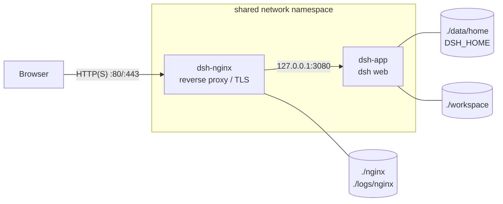

# DSH-Server

[](https://github.com/StanleyChanH/DSH-Server/actions/workflows/ci.yml) [](LICENSE)

[中文](README.md) | English

Deploy the [DeepSeek Harness](https://github.com/deepseek-ai/deepseek-harness) (`dsh`) Web UI with Docker Compose, published to the internet through an Nginx reverse proxy.

> [!WARNING]
> DeepSeek Harness is an upstream **developer preview** that has not been security audited. Anyone holding the login link can make the agent run arbitrary commands inside the container. Read [Security model](#security-model) and [SECURITY.md](SECURITY.md) before deploying.

> This is a community deployment recipe, not affiliated with DeepSeek.

## Features

- **Three steps**: `init` → `up` → open the link
- **dsh is never exposed directly**: it listens on `127.0.0.1` inside Nginx's network namespace and is reachable only through Nginx
- **HTTP / HTTPS switch**: HTTPS mode adds a 301 redirect, HSTS, and `Secure` on the session cookie
- **WebSocket and long-lived streams** are forwarded; the browser `Host` is preserved so dsh's DNS-rebinding fence accepts it
- **All state lives in the project directory**: config, API keys, sessions, workspace, certificates, and logs are bind mounts, easy to back up and move
- **Mirror-friendly**: defaults to China mirrors (DaoCloud, npmmirror, Aliyun apt); one line switches back to the official registries
- **Ops details**: non-root runtime with host-matched uid/gid, health checks, log rotation, startup tokens masked in access logs, optional Basic Auth

## Architecture



dsh **refuses wildcard bind addresses** such as `0.0.0.0`. The `dsh` service therefore joins the Nginx container's network namespace (`network_mode: service:nginx`) and listens on loopback only. Neither the host nor any other container can reach the dsh port.

## Requirements

- A Linux host with Docker Engine 24+ and Docker Compose v2
- At least 2 GB of free disk (the image is about 1 GB)
- A [DeepSeek API key](https://platform.deepseek.com/) (other OpenAI-compatible providers also work)
- On cloud servers, open `HTTP_PORT` / `HTTPS_PORT` in the security group or firewall

## Quick start

```sh
git clone https://github.com/StanleyChanH/DSH-Server.git && cd DSH-Server

# 1. Create .env and the mounted directories. The argument is the IP, domain, or full URL browsers will use
./scripts/init.sh 203.0.113.10          # or: make init HOST=203.0.113.10

# 2. Build and start
docker compose up -d --build            # or: make up

# 3. Print the login link (contains the startup token)
./scripts/show-url.sh                   # or: make url
```

After you open the link in a browser:

1. dsh trades the one-time token for a signed cookie (valid 30 days by default) and redirects to the token-free URL
2. Open **Settings → Models**, enter your DeepSeek API key, and save. It takes effect immediately
3. Click **Select workspace** and add `/workspace` or a subdirectory (that is `./workspace/` on the host)

## Configuration

All settings live in `.env`; [.env.example](.env.example) documents each one. Apply changes with `docker compose up -d`.

| Variable | Default | Description |
|---|---|---|
| `DSH_PUBLIC_URL` | – | Root URL browsers use, e.g. `https://dsh.example.com/`. The printed login link is built from it |
| `DSH_TRUSTED_HOSTS` | – | Comma-separated hostnames or IPs from the browser's address bar. **Any other authority gets 403 on every API call.** Entries without a port match any port |
| `DSH_SERVER_NAME` | `_` | Nginx `server_name` |
| `NGINX_MODE` | `http` | `http` or `https` |
| `HTTP_PORT` / `HTTPS_PORT` | `80` / `443` | Published host ports |
| `NGINX_CLIENT_MAX_BODY_SIZE` | `200m` | Upload size limit |
| `DSH_VERSION` | `0.2.1-rc.5` | Version of the npm package [`@deepseek-ai/dsh`](https://www.npmjs.com/package/@deepseek-ai/dsh) |
| `DSH_EXTRA_ARGS` | – | Extra arguments passed to `dsh web` |
| `DSH_UID` / `DSH_GID` | `1000` | Container user; must own `data/` and `workspace/` on the host |
| `REGISTRY_PREFIX` | `docker.m.daocloud.io/library/` | Base image prefix; leave empty for Docker Hub |
| `NPM_REGISTRY` | `https://registry.npmmirror.com` | npm registry |
| `APT_MIRROR` | `mirrors.aliyun.com` | Debian apt mirror; leave empty for the official one |

For local changes you don't want to commit (extra mounts, resource limits), use `docker-compose.override.yml`. It is git-ignored and Compose loads it automatically.

### HTTPS (strongly recommended for public deployments)

In HTTP mode the login token and the session cookie travel in clear text.

```sh
cp /path/to/fullchain.pem nginx/certs/fullchain.pem
cp /path/to/privkey.pem   nginx/certs/privkey.pem
./scripts/init.sh https://dsh.example.com/   # sets NGINX_MODE=https, PUBLIC_URL, TRUSTED_HOSTS
docker compose up -d
```

In HTTPS mode port 80 redirects to HTTPS with a 301, HSTS is enabled, and Nginx adds `Secure` to dsh's session cookie. After replacing certificates, run `make reload`.

### Optional: Nginx Basic Auth

To add a username and password in front of dsh's own authentication, see [nginx/snippets/auth/README.md](nginx/snippets/auth/README.md).

### Customizing Nginx

- Site templates: [nginx/templates/](nginx/templates/), rendered from `.env` variables when the container starts
- Shared proxy settings: [nginx/snippets/dsh-proxy.conf](nginx/snippets/dsh-proxy.conf)
- Extra server blocks: `nginx/custom.d/*.conf` (not committed)

## Layout

```
.
├── docker-compose.yml          # nginx + dsh
├── .env.example                # configuration template (copy to .env)
├── Makefile                    # shortcuts (make help)
├── dsh/
│   ├── Dockerfile              # Node 24 + @deepseek-ai/dsh
│   └── entrypoint.sh           # builds `dsh web` arguments from env vars
├── nginx/
│   ├── nginx.conf              # main config (token masking in logs, WebSocket map)
│   ├── templates/{http,https}/ # site templates, mounted according to NGINX_MODE
│   ├── snippets/               # shared proxy settings, optional Basic Auth
│   ├── custom.d/               # your own config (not committed)
│   └── certs/                  # TLS certificates (not committed)
├── scripts/
│   ├── init.sh                 # create .env and mounted directories
│   ├── install-plugins.sh      # install the lingshu dsh-memory plugin (make plugins)
│   └── show-url.sh             # print the current login link
├── data/home/      ─┐          # → /home/dsh; DSH_HOME=data/home/.dsh (API keys, sessions, plugins, credentials)
├── workspace/       ├ runtime  # → /workspace; agent workspace
└── logs/nginx/     ─┘          # Nginx logs
```

## Plugin: lingshu long-term memory (optional)

[lingshu dsh-memory](https://github.com/FuRongJun-1999/dsh-memory) gives the agent cross-session long-term memory: conversations settle into a plain-text cognitive graph, and the agent gains the `cg` / `stg` memory tools. The upstream project verified it against dsh `0.2.1-rc.5`.

```bash
make plugins                  # = ./scripts/install-plugins.sh (stack must be running)
docker compose up -d dsh      # recreate the container with MDCG_TOKEN (issues a new login token)
```

The script follows the upstream manual install: clone a pinned tag (default `v0.9.23`; override with `DSH_MEMORY_VERSION=<tag> make plugins`), build inside the container, `dsh plugin --profile web add`, write the profile `cordis.patch.yml` override, and derive the write credential into `MDCG_TOKEN` in `.env`. Re-running is idempotent and also upgrades the plugin.

Notes:

- **Memory store**: `data/home/.dsh/.dsh-memory/data/mdcg` — inside the bind mount, survives container rebuilds and plugin upgrades
- **Writes are fail-closed**: without `MDCG_TOKEN` the brain runs read-only (guest); the script derives the token per the upstream recommended scheme, with narrowed ops/layers allowlists
- **Verify**: `docker compose logs dsh | grep -i lingshu`; then tell the agent "remember: …" and ask again in a new session
- **Uninstall**: `docker compose exec dsh dsh plugin --profile web remove @furongjun1999/dsh-memory`, drop the `furongjun1999-dsh-memory` entry from `data/home/.dsh/profiles/web/cordis.patch.yml` and `MDCG_TOKEN` from `.env`, then `docker compose up -d dsh`

## Operations

| Task | Command |
|---|---|
| Status | `make ps` |
| Logs | `make logs`, or `docker compose logs -f dsh` |
| Current login link | `make url` |
| Restart dsh (issues a new token) | `make restart` |
| Validate and hot-reload Nginx | `make reload` |
| Shell inside dsh | `make shell` |
| Install another dsh plugin | `docker compose exec dsh dsh plugin --profile web add <npm-package>` |
| Stop (data is kept) | `make down` |

**Upgrading dsh**: check available versions (`npm view @deepseek-ai/dsh dist-tags`), change `DSH_VERSION` in `.env`, then run `make upgrade`. Upstream changes quickly and may break compatibility, so back up `data/` first.

**Backup**: `.env`, `data/`, `workspace/`, and `nginx/certs/` are enough to restore everything.

> [!NOTE]
> dsh shares the Nginx network namespace. If you recreate only the Nginx container (e.g. `docker compose up -d --force-recreate nginx`), run `docker compose up -d` again so dsh is recreated too.

## Security model

- **Single owner**: dsh has no user accounts. Each process start issues a new startup token, and whoever opens the login link gets the owner session. That session can read and write `workspace/` and `data/home/` and have the agent run commands in the container. **Share the link only with people you trust.**
- **Sessions**: cookies are valid for 30 days by default. The signing key persists in `data/home/.dsh/.credentials.yaml`, so logged-in browsers stay logged in across restarts.
- **Revoking all sessions**: delete the `client-connection/browser-session` record from `.credentials.yaml`, then run `make restart`.
- **Host fence**: dsh accepts only loopback or a `Host` listed in `DSH_TRUSTED_HOSTS`. This defends against DNS rebinding and cross-site requests.
- **Blast radius**: the agent can reach everything in the dsh container, including the mounted `workspace/` and `data/home/`. Never mount the Docker socket or sensitive host directories.

See [SECURITY.md](SECURITY.md) for how to report vulnerabilities.

## Troubleshooting

| Symptom | Cause and fix |
|---|---|
| Page loads but every action returns 403 | The hostname in the address bar is not in `DSH_TRUSTED_HOSTS`. Add it and run `docker compose up -d` |
| Opening the link returns 401 | The link has no token, or the token expired after a restart. Run `make url` for the current link |
| 502 Bad Gateway | dsh is still starting or has exited. Check `docker compose logs dsh` |
| Logs say `is not writable` | Wrong owner on the mounted directories: `sudo chown -R $(id -u):$(id -g) data/home workspace`, and check `DSH_UID/DSH_GID` in `.env` |
| Public IP unreachable from the server itself | Many clouds have no hairpin NAT, so an instance can't reach its own public IP. Test from outside or use the private IP |
| Image or npm downloads time out during build | Adjust `REGISTRY_PREFIX`, `NPM_REGISTRY`, and `APT_MIRROR` |

## Contributing

Issues and PRs are welcome. Please read [CONTRIBUTING.md](CONTRIBUTING.md) first. Changes are listed in [CHANGELOG.md](CHANGELOG.md).

## License

The deployment files in this repository are released under the [MIT](LICENSE) license. DeepSeek Harness itself is covered by its [upstream license](https://github.com/deepseek-ai/deepseek-harness/blob/main/LICENSE).
