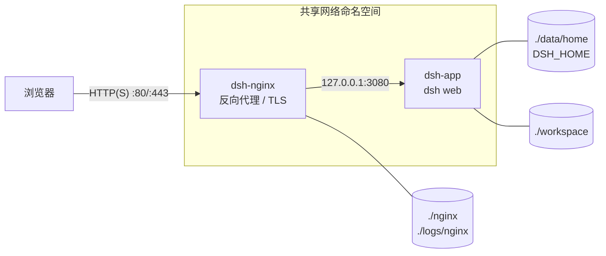

# DSH-Server

[](https://github.com/StanleyChanH/DSH-Server/actions/workflows/ci.yml) [](LICENSE)

中文 | [English](README.en.md)

用 Docker Compose 一键部署 [DeepSeek Harness](https://github.com/deepseek-ai/deepseek-harness)（`dsh`）的 Web UI，并通过 Nginx 反向代理安全地提供给外网用户访问。

> [!WARNING]
> DeepSeek Harness 是上游的**开发者预览**版本，未经安全审计。拿到登录链接的人可以让 Agent 在容器内执行任意命令。部署前请阅读 [安全模型](#安全模型) 与 [SECURITY.md](SECURITY.md)。

> 本项目是社区部署方案，与 DeepSeek 官方无隶属关系。

## 特性

- **开箱即用**：`init` → `up` → 打开链接，三步完成部署
- **dsh 不直接暴露**：dsh 只监听 `127.0.0.1`，与 Nginx 共用网络命名空间，只能经由 Nginx 访问
- **HTTP / HTTPS 一键切换**：HTTPS 模式自动 301 跳转、HSTS，并为会话 cookie 补上 `Secure`
- **WebSocket、长连接**均已正确转发；保留浏览器 `Host` 以通过 dsh 的 DNS rebinding 防护
- **数据全部在项目目录**：配置、API Key、会话、工作区、证书、日志都以 bind mount 挂载，便于备份和迁移
- **国内网络友好**：默认使用 DaoCloud 镜像、npmmirror、阿里云 apt 源，一行配置即可切回官方源
- **运维细节**：非 root 运行、uid/gid 与宿主机对齐、健康检查、日志轮转、访问日志中的 token 自动打码、可选 Basic Auth

## 架构



dsh 出于安全考虑**拒绝监听 `0.0.0.0`** 等通配地址。本项目让 `dsh` 服务以 `network_mode: service:nginx` 加入 Nginx 容器的网络命名空间，dsh 只监听回环地址，宿主机和其他容器都访问不到 dsh 端口。

## 环境要求

- Linux 主机，Docker Engine 24+ 与 Docker Compose v2
- 至少 2 GB 可用磁盘（镜像约 1 GB）
- 一个 [DeepSeek API Key](https://platform.deepseek.com/)（也支持其他 OpenAI 兼容提供方）
- 云服务器需在安全组/防火墙放行 `HTTP_PORT`、`HTTPS_PORT`

## 快速开始

```sh
git clone https://github.com/StanleyChanH/DSH-Server.git && cd DSH-Server

# 1. 生成 .env 并创建挂载目录；参数为浏览器访问的 IP、域名或完整 URL
./scripts/init.sh 203.0.113.10          # 或：make init HOST=203.0.113.10

# 2. 构建并启动
docker compose up -d --build            # 或：make up

# 3. 获取带 token 的登录链接
./scripts/show-url.sh                   # 或：make url
```

在浏览器中打开登录链接后：

1. dsh 用链接里的一次性 token 换取签名 cookie（默认 30 天有效），然后跳转到不带 token 的地址
2. 进入 **设置 → 模型**，填写 DeepSeek API Key 并保存，立即生效
3. 点击 **选择工作区**，添加 `/workspace` 或其子目录（对应宿主机的 `./workspace/`）

## 配置

所有配置都在 `.env` 中，完整说明见 [.env.example](.env.example)。修改后执行 `docker compose up -d` 生效。

| 变量 | 默认值 | 说明 |
|---|---|---|
| `DSH_PUBLIC_URL` | – | 浏览器访问的根地址，如 `https://dsh.example.com/`。日志中打印的登录链接以它为准 |
| `DSH_TRUSTED_HOSTS` | – | 浏览器地址栏中的主机名或 IP，逗号分隔。**不在列表中的访问地址，所有 API 都返回 403**。不带端口时匹配任意端口 |
| `DSH_SERVER_NAME` | `_` | Nginx `server_name` |
| `NGINX_MODE` | `http` | `http` 或 `https` |
| `HTTP_PORT` / `HTTPS_PORT` | `80` / `443` | 宿主机对外端口 |
| `NGINX_CLIENT_MAX_BODY_SIZE` | `200m` | 上传大小上限 |
| `DSH_VERSION` | `0.2.1-rc.5` | npm 包 [`@deepseek-ai/dsh`](https://www.npmjs.com/package/@deepseek-ai/dsh) 的版本 |
| `DSH_EXTRA_ARGS` | – | 透传给 `dsh web` 的额外参数 |
| `DSH_UID` / `DSH_GID` | `1000` | 容器运行用户，需与 `data/`、`workspace/` 的属主一致 |
| `REGISTRY_PREFIX` | `docker.m.daocloud.io/library/` | 基础镜像前缀，留空即用 Docker Hub |
| `NPM_REGISTRY` | `https://registry.npmmirror.com` | npm 源 |
| `APT_MIRROR` | `mirrors.aliyun.com` | Debian apt 源，留空即用官方源 |

不希望提交到仓库的本地改动（如额外挂载、资源限制）可以写在 `docker-compose.override.yml` 里。该文件已加入 .gitignore，Compose 会自动加载。

### 启用 HTTPS（公网部署强烈推荐）

HTTP 模式下，登录 token 和会话 cookie 都以明文传输。

```sh
cp /path/to/fullchain.pem nginx/certs/fullchain.pem
cp /path/to/privkey.pem   nginx/certs/privkey.pem
./scripts/init.sh https://dsh.example.com/   # 会设置 NGINX_MODE=https、PUBLIC_URL、TRUSTED_HOSTS
docker compose up -d
```

HTTPS 模式下，80 端口会 301 跳转到 HTTPS，并开启 HSTS，Nginx 也会给 dsh 的会话 cookie 加上 `Secure`。更换证书后执行 `make reload`。

### 可选：Nginx Basic Auth

在 dsh 自身认证之外再加一层账号密码，步骤见 [nginx/snippets/auth/README.md](nginx/snippets/auth/README.md)。

### 自定义 Nginx

- 站点模板：[nginx/templates/](nginx/templates/)，容器启动时用 `.env` 中的变量渲染
- 反代公共参数：[nginx/snippets/dsh-proxy.conf](nginx/snippets/dsh-proxy.conf)
- 额外的 server 配置：放在 `nginx/custom.d/*.conf`（不入库）

## 目录结构

```
.
├── docker-compose.yml          # 编排：nginx + dsh
├── .env.example                # 配置模板（复制为 .env）
├── Makefile                    # 常用命令快捷方式（make help）
├── dsh/
│   ├── Dockerfile              # Node 24 + @deepseek-ai/dsh
│   └── entrypoint.sh           # 由环境变量组装 `dsh web` 参数
├── nginx/
│   ├── nginx.conf              # 主配置（访问日志 token 打码、WebSocket map）
│   ├── templates/{http,https}/ # 站点模板，按 NGINX_MODE 挂载
│   ├── snippets/               # 反代公共参数、可选 Basic Auth
│   ├── custom.d/               # 自定义配置（不入库）
│   └── certs/                  # TLS 证书（不入库）
├── scripts/
│   ├── init.sh                 # 初始化 .env 与挂载目录
│   └── show-url.sh             # 打印当前登录链接
├── data/home/      ─┐          # → /home/dsh；DSH_HOME=data/home/.dsh（API Key、会话、插件、凭据）
├── workspace/       ├ 运行时   # → /workspace；Agent 工作区
└── logs/nginx/     ─┘ 生成     # Nginx 日志
```

## 运维

| 操作 | 命令 |
|---|---|
| 状态 | `make ps` |
| 日志 | `make logs`，或 `docker compose logs -f dsh` |
| 当前登录链接 | `make url` |
| 重启 dsh（会生成新 token） | `make restart` |
| 检查并热加载 Nginx 配置 | `make reload` |
| 进入 dsh 容器 | `make shell` |
| 安装 dsh 插件 | `docker compose exec dsh dsh plugin --profile web add <npm 包>` |
| 停止（保留数据） | `make down` |

**升级 dsh**：先查看可用版本（`npm view @deepseek-ai/dsh dist-tags`），修改 `.env` 中的 `DSH_VERSION`，再执行 `make upgrade`。上游处于快速迭代期，可能有不兼容变更，升级前请先备份 `data/`。

**备份**：备份 `.env`、`data/`、`workspace/` 和 `nginx/certs/` 即可完整恢复。

> [!NOTE]
> dsh 共用 nginx 的网络命名空间。单独重建 nginx 容器后（如 `docker compose up -d --force-recreate nginx`），需要再执行一次 `docker compose up -d`，让 dsh 一起重建。

## 安全模型

- **单一 owner**：dsh 没有多用户体系。每次进程启动都会生成新的启动 token，打开登录链接的人就获得 owner 会话，可以读写 `workspace/` 与 `data/home/`，并让 Agent 在容器内执行命令。**只把链接发给可信的人。**
- **会话**：cookie 默认 30 天有效，签名密钥持久化在 `data/home/.dsh/.credentials.yaml`，所以重启后已登录的浏览器依然有效。
- **撤销全部会话**：从 `.credentials.yaml` 中删除 `client-connection/browser-session` 记录，然后执行 `make restart`。
- **Host 校验**：dsh 只接受回环地址或 `DSH_TRUSTED_HOSTS` 中列出的 `Host`，用于防御 DNS rebinding 和跨站请求。
- **隔离边界**：Agent 能接触到的是 dsh 容器内的一切，包括挂载进来的 `workspace/` 和 `data/home/`。不要挂载 Docker socket 或敏感的宿主机目录。

漏洞报告方式见 [SECURITY.md](SECURITY.md)。

## 常见问题

| 现象 | 原因与处理 |
|---|---|
| 页面能打开，但所有操作报 403 | 浏览器地址栏里的主机名不在 `DSH_TRUSTED_HOSTS` 中。补上后执行 `docker compose up -d` |
| 打开链接返回 401 | 链接中没有 token，或 token 已因重启失效。用 `make url` 获取最新链接 |
| 502 Bad Gateway | dsh 仍在启动或已退出。查看 `docker compose logs dsh` |
| 日志提示 `is not writable` | 挂载目录属主不对：`sudo chown -R $(id -u):$(id -g) data/home workspace`，并确认 `.env` 中的 `DSH_UID/DSH_GID` |
| 云服务器本机访问公网 IP 不通 | 很多云厂商不支持从实例内部回环访问自己的公网 IP（无 hairpin NAT），请从外部测试或改用内网 IP |
| 构建时拉取镜像或 npm 超时 | 调整 `REGISTRY_PREFIX`、`NPM_REGISTRY`、`APT_MIRROR` |

## 参与贡献

欢迎提交 Issue 和 PR，请先阅读 [CONTRIBUTING.md](CONTRIBUTING.md)。变更记录见 [CHANGELOG.md](CHANGELOG.md)。

## 许可证

本仓库的部署配置以 [MIT](LICENSE) 许可发布。DeepSeek Harness 本身遵循其[上游许可证](https://github.com/deepseek-ai/deepseek-harness/blob/main/LICENSE)。
